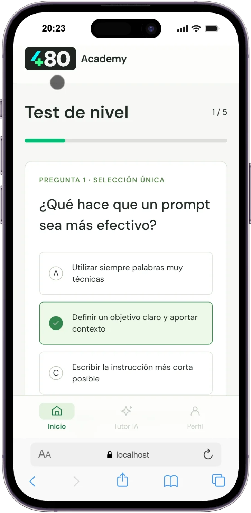
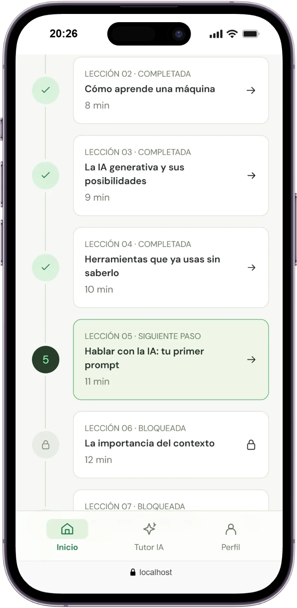
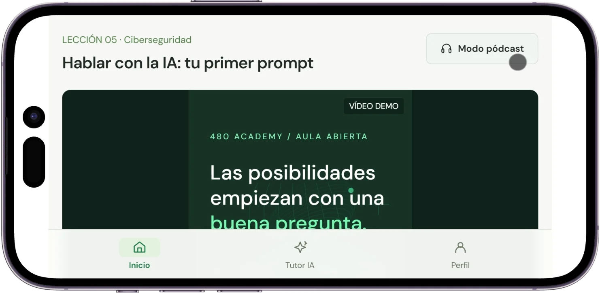
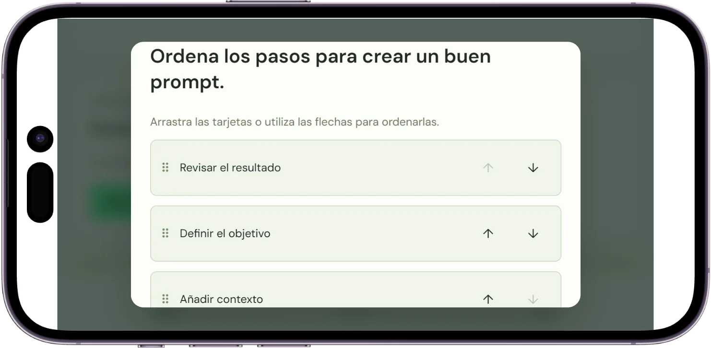
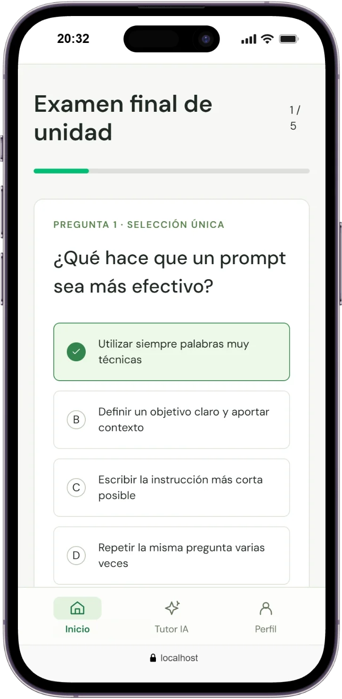
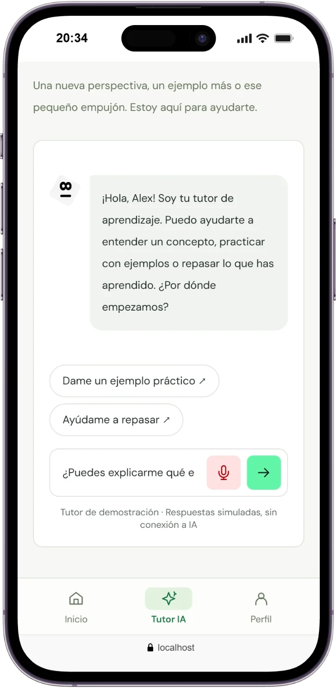
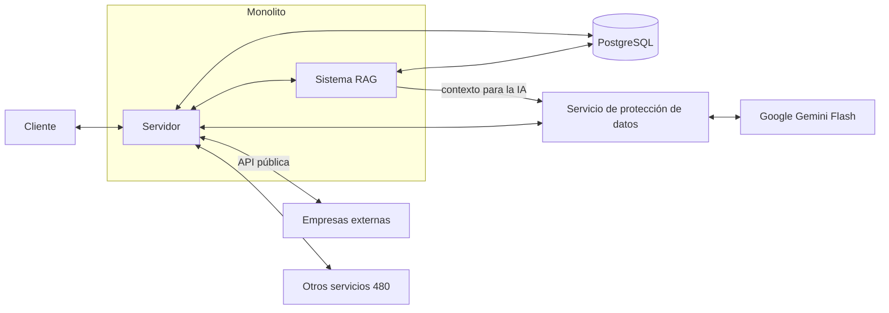

# SPEC: Paquete de diseño

## Índice

1. [El alumno y su problema](#1-el-alumno-y-su-problema)
2. [Flujo del alumno](#2-flujo-del-alumno)
3. [Respuesta a los problemas](#3-respuesta-a-los-problemas)
4. [Historias de usuario](#4-historias-de-usuario)
5. [Arquitectura](#5-arquitectura)
6. [Modelo de datos y flujo hacia la IA](#6-modelo-de-datos-y-flujo-hacia-la-ia)
7. [Agentes de IA](#7-agentes-de-ia)
8. [Contenido](#8-contenido)
9. [Coste](#9-coste)
10. [Idea original](#10-idea-original)
11. [Alcance para el 30/11](#11-alcance-para-el-3011)

## 1. El alumno y su problema

Ahora mimso el alumnado no se ve los videos enteros dado al problema de la experiencia de usuario, la interfaz, formato tradicional sin personalización adaptada a cada alumno

## 2. Flujo del alumno

- **Inicio:** el alumno ve sus cursos, módulos y progreso.
- **Examen inicial del curso:** al inscribirse, responde una sola evaluación con preguntas de todos los contenidos. No es una nota; adapta el orden de módulos y marca como completados los contenidos que ya domina.
- **Itinerario:** ve qué contenidos debe hacer y cuáles se salta, y puede recuperar los saltados.
- **Contenido:** ve el vídeo o escucha el podcast y elige si responde durante el contenido o al final.
- **Resultados:** ve sus aciertos, sus fallos y la explicación de cada pregunta.
- **Repaso:** ve vídeos cortos verticales sobre lo que ha fallado.
- **Tutor IA:** habla por voz con un tutor que conoce sus errores.

### Mockups de las pantallas

<table>
  <tr>
    <td align="center"> <em>Cuestionario inicial</em></td>
    <td align="center"> <em>Itinerario</em></td>
  </tr>
</table>

<table>
  <tr>
    <td align="center"> <em>Vídeo módulo</em></td>
    <td align="center"> <em>Cuestionario vídeo</em></td>
  </tr>
</table>

<table>
  <tr>
    <td align="center"> <em>Examen final</em></td>
    <td align="center"> <em>Tutor IA</em></td>
  </tr>
</table>

## 3. Respuesta a los problemas

## Problema 1
El formato tradicional de videos en la epoca actual del contenido vertical y rápido hace que los alumnos no completen los videos del módulo y los salten.

### Corrección
- Generación de podcast a partir de videos para usar como metodo de estudio y videos rápidos verticales editados automáticamente mediante IA de los fallos en encuestas/tests de los vídeos.

## Problema 2:
Los alumnos no tienen atención cercana ni personalizada de un tutor responsable.

### Corrección
- Generación de llamada de voz en directo mediante lenguaje natural con un tutor IA con los datos del usuario y información de sus errores en encuestas/test

## Problema 3:
No se sabe si el alumno aprende ya que solo se hace un examen al final

### Corrección
- Se harán encuestas/test dinámicos en los videos/podcasts para poder comprobar si el usuario ha entendido los conocimientos de esa parte del módulo, podrá elegir si en la parte del vídeo contestar a esa pregunta o a todas al final

## Problema 4:
Los itineratrios son iguales para todos, quien sabe conocimiento de parte del módulo tiene que ver videos que ya sabe el contenido

### Corrección
- Realizar una unica encuesta de personalización de contenido al empezar cada módulo para saber si es conocedor de parte de contenido del módulo 
para saltar videos y encuestas 

## 4. Historias de usuario

<!-- Entre 5 y 8, con prioridad y criterios de aceptación. -->

| ID | Caso de uso | Historia de usuario | Prioridad | Criterios de aceptación |
|---|---|---|---|---|
| **HU-01** | Evaluación inicial del alumno | Como alumno de 480 Academy, quiero realizar un cuestionario inicial con preguntas escritas, visuales y mediante diálogo con IA antes de comenzar un curso, para identificar los conocimientos que ya domino y evitar consumir tiempo en contenidos que no necesito aprender. | Imprescindible | - Presentar el test inicial antes de comenzar el curso. - Permitir preguntas escritas, visuales y respuestas mediante diálogo con IA. - Evaluar las respuestas e identificar los conocimientos dominados. - Permitir omitir del itinerario los contenidos dominados. - Comprobar en el examen final los conocimientos evaluados inicialmente. |
| **HU-02** | Itinerario de aprendizaje personalizado | Como alumno de 480 Academy, quiero recibir un itinerario adaptado a mis conocimientos previos, para centrarme en los contenidos que necesito aprender y avanzar a mi propio ritmo. | Imprescindible | - Generar el itinerario a partir de los resultados del test inicial. - Permitir omitir los contenidos que el alumno ya domina. - Mostrar los módulos y contenidos pendientes. - Adaptar el itinerario a los conocimientos identificados inicialmente. |
| **HU-03** | Aprendizaje mediante vídeos y cuestionarios interactivos | Como alumno de 480 Academy, quiero realizar cuestionarios durante los vídeos formativos, para comprobar mi comprensión del contenido y mantenerme activo durante la formación. | Imprescindible | - Introducir preguntas durante la reproducción de los vídeos. - Admitir formatos visuales e interactivos, como arrastrar y soltar o relacionar elementos mediante flechas. - Permitir responder o saltar las preguntas. - Indicar si cada respuesta es correcta o incorrecta. - Incorporar al test final del vídeo las preguntas omitidas. |
| **HU-04** | Evaluación final del aprendizaje | Como alumno de 480 Academy, quiero realizar un examen final que incluya las preguntas del test inicial y las que haya dejado sin responder durante los vídeos, para comprobar realmente lo aprendido durante el curso. | Imprescindible | - Mantener el formato del test inicial. - Incluir preguntas escritas, visuales y mediante diálogo con IA. - Incorporar las preguntas omitidas en los cuestionarios intermedios. - Evaluar también los conocimientos que el alumno dominaba al comenzar. - Mostrar los resultados al finalizar la evaluación. |
| **HU-05** | Tutor virtual basado en IA | Como alumno de 480 Academy, quiero disponer de un tutor virtual basado en IA al que pueda realizar preguntas sobre los contenidos del curso, para resolver mis dudas y recibir acompañamiento personalizado. | Imprescindible | - Permitir iniciar una conversación con el tutor virtual. - Responder preguntas relacionadas con los contenidos formativos. - Adaptar las respuestas al contexto del curso y al conocimiento del alumno. - Utilizar los resultados de los cuestionarios para orientar las explicaciones. - Disponibilizar el tutor desde una interfaz móvil. |
| **HU-06** | Revisión personalizada de errores y recomendaciones | Como alumno de 480 Academy, quiero consultar mis errores frecuentes, recomendaciones y fragmentos de vídeo relacionados con mis dificultades, para reforzar los conceptos que peor comprendo y mejorar mi aprendizaje. | Imprescindible | - Identificar errores y dificultades recurrentes. - Presentar los errores y recomendaciones en una lista vertical con scroll. - Incluir una explicación o consejo personalizado en cada recomendación. - Mostrar la marca temporal de los fragmentos de vídeo relacionados. - Permitir acceder directamente al fragmento correspondiente. |
| **HU-07** | Accesibilidad mediante transcripciones y podcasts | Como alumno de 480 Academy, quiero consultar las transcripciones de los vídeos y convertir los contenidos compatibles en podcasts, para estudiar de diferentes maneras y acceder al material incluso sin visualizar los vídeos. | Deseable | - Ofrecer la transcripción textual de los vídeos disponibles. - Relacionar la transcripción con el contenido y los tiempos del vídeo. - Permitir consultar el texto desde dispositivos móviles. - Transformar los contenidos compatibles en formato podcast. - Permitir escuchar el contenido sin visualizar el vídeo. |
| **HU-08** | Seguimiento del progreso del alumno | Como alumno de 480 Academy, quiero consultar mi progreso y los resultados de mis evaluaciones, para conocer mi evolución, identificar mis puntos débiles y saber qué debo reforzar. | Imprescindible | - Mostrar los módulos completados y pendientes. - Mostrar los resultados de las evaluaciones iniciales, intermedias y finales. - Permitir identificar los contenidos que necesita reforzar el alumno. |
- La información debe actualizarse conforme el alumno avance en el curso.
- El seguimiento debe poder consultarse desde un dispositivo móvil.

## 5. Arquitectura

Para un MVP, un único servidor concentra la lógica y conecta al cliente con los datos, la IA y los servicios externos. Es una arquitectura rápida de construir y conterizar con Docker.

- **Cliente:** interfaz donde el alumno ve vídeos, escucha podcasts, responde tests/examenes y hace tutor-IA.
- **Servidor:** Gestiona usuarios, cursos, encuestas, tests y progreso, y coordina las peticiones a la IA con un servicio intermediario para no revelar datos sensibles a la IA.
- **PostgreSQL:** guarda los usuarios, los módulos, las transcripciones, las respuestas y el progreso.
- **Sistema RAG:** módulo del monolito que recupera de PostgreSQL las transcripciones del módulo, los errores del alumno y la lista de columnas permitidas para que la IA responda a medida (detalle en el apartado 6).
- **Servicio de protección de datos:** paso obligatorio entre el servidor y el LLM. Elimina o seudonimiza los datos personales antes de enviarlos a la IA.
- **LLM (Google Gemini, modelo Flash):** selecciona los fragmentos de repaso, escribe los guiones de podcast y da respuesta al alumno como tutor IA. Solo recibe datos ya protegidos.
- **Empresas externas:** se conectan con el servidor mediante una API pública.
- **Otros servicios 480:** otros sistemas de 480 con los que el servidor intercambia información.

## 6. Modelo de datos y flujo hacia la IA

### Entidades principales

| Entidad | Datos principales | Relaciones |
| --- | --- | --- |
| Usuario | id, nombre, apellidos, email, password_hash, edad, consentimiento de datos y fecha, preferencia de bolsa de trabajo, rol | Un tutor tiene varios alumnos; solo cuentas de 18 años o más pueden activar la preferencia de bolsa |
| Curso | id, título, descripción | Tiene varios módulos |
| Módulo | id, título, orden | Pertenece a un curso y tiene varios contenidos |
| Contenido | id, tipo (vídeo / podcast / vídeo corto), título, URL, transcripción | Pertenece a un módulo. El podcast y el vídeo corto se generan a partir de vídeos |
| Evaluación | id, tipo (inicial / intermedia / final), título | La inicial pertenece al curso; las intermedias y finales se asocian a un contenido |
| Pregunta | id, tipo (encuesta inicial / test), enunciado, opciones, respuesta correcta, explicación, concepto, minuto | Pertenece a un módulo y, si es de test, a un contenido |
| Respuesta | id, respuesta, acierto, fecha | Une a un alumno con una pregunta |
| Progreso | estado (pendiente / completado / saltado), fecha | Une a un alumno con un contenido |
| Sesión de tutoría | id, fecha, duración, resumen | Pertenece a un alumno y a un módulo |

### Datos del alumno que salen hacia la IA

| Dato | ¿Sale hacia la IA? | Para qué |
| --- | --- | --- |
| Nombre y email | No | No son necesarios |
| Contraseña y hash de contraseña | No | Se usan únicamente para autenticación |
| Identificador real del alumno | No | No es necesario |
| Edad, consentimiento y preferencia de bolsa | No | Se usan únicamente para registro y reglas de acceso |
| Preguntas falladas y conceptos asociados | Sí | Personalizar el tutor y los vídeos cortos |
| Resultado de la encuesta inicial | Sí | Adaptar las explicaciones a lo que ya sabe |
| Módulo y contenido actual | Sí | Dar contexto al tutor |
| Lo que dice el alumno al tutor | Sí, transcrito y filtrado | Responder a sus dudas |
| Audio original de la voz | No | Se transcribe antes y al LLM solo llega texto |

Las transcripciones de los vídeos también se envían, pero son contenido del curso y no datos del alumno.

### Tratamiento para cumplir la condición de privacidad

1. **Minimización:** el servidor solo prepara los datos necesarios para cada petición.
2. **Seudonimización:** el identificador real se sustituye por uno temporal de sesión. La correspondencia no sale de nuestro sistema.
3. **Filtrado del texto libre:** el servicio de protección de datos detecta y sustituye nombres, emails, teléfonos y documentos de identidad, por ejemplo por `[NOMBRE]` o `[EMAIL]`.
4. **Voz:** el audio se transcribe dentro de nuestro sistema, el texto se filtra y después se envía al LLM. El audio no se guarda.
5. **Paso obligatorio:** ninguna petición llega al LLM sin pasar por el servicio. Si falla, no se envía nada.
6. **Proveedor de IA:** usamos Google Gemini (modelo Flash) a través de la API de pago.
7. **Transparencia:** se informa al alumno de que habla con una IA y de qué datos se utilizan.

El filtrado automático puede no detectar todos los datos personales, por lo que se pide al alumno que no los comparta con el tutor.

### Sistema RAG

El RAG recupera de PostgreSQL las transcripciones del módulo actual, los errores del alumno y las columnas permitidas, y se los da filtrando sin ningún dato de personal a Gemini como contexto para que responda a medida. Sus límites son:

- **Columnas permitidas:** la IA solo conoce las de una lista cerrada, sin nombre, email, contraseñas ni identificadores reales.
- **Sin SQL libre:** solo puede solicitar consultas predefinidas de lectura, y el servidor las limita al alumno de la sesión.
- **Protección de datos:** todo el contexto se filtra antes de llegar a Gemini.

Detalle en [docs/rag.md](docs/rag.md).

## 7. Agentes de IA

| Agente | Qué hace | Modelo y por qué | Entrada | Salida | Límites |
| --- | --- | --- | --- | --- | --- |
| Tutor | Resuelve dudas de forma personalizada | Gemini Flash: rápido y con coste contenido | Pregunta filtrada, transcripciones del módulo y errores del alumno | Respuesta en texto, que se convierte en voz | Solo el curso, solo los datos del alumno y sin SQL libre |
| Evaluador inicial | Identifica conocimientos previos y adapta el recorrido | Gemini Flash | Respuestas del diagnóstico filtradas, preguntas y referencias del curso | Contenidos dominados y orden de módulos en JSON validado | No recibe identidad del alumno ni decide calificaciones |
| Selector de repaso | Elige el fragmento de vídeo que explica un fallo | Gemini Flash: trabaja con el texto de la transcripción | Pregunta fallada y transcripción con minutos | Minuto de inicio, minuto de fin y título | Máximo 60 s y no genera imágenes. El recorte lo hace el servidor |
| Guionista de podcast | Convierte los vídeos en un guion de audio | Gemini Flash: resume y adapta el texto | Transcripciones del módulo | Guion del podcast | Solo contenido del curso y no recibe datos del alumno |

Gemini analiza las respuestas filtradas del examen inicial y devuelve decisiones estructuradas sobre los contenidos dominados y el orden de módulos. El servidor valida esas decisiones y las guarda en el itinerario personal. El examen inicial ocurre antes del árbol y no aparece como un paso dentro de él.

Las preguntas tampoco usan IA: quien sube los vídeos escribe a mano las de la encuesta inicial y los tests, con su respuesta correcta, explicación, concepto y minuto.

## 8. Contenido

### Curso de prueba: CS50P

Usaremos [CS50’s Introduction to Programming with Python (CS50P)](https://cs50.harvard.edu/python/), curso abierto de Harvard con diez lecciones, organizadas en estos módulos:

| # | Módulo en 480 Academy | Título original |
| --- | --- | --- |
| 1 | Funciones y variables | Functions, Variables |
| 2 | Condicionales | Conditionals |
| 3 | Bucles | Loops |
| 4 | Excepciones | Exceptions |
| 5 | Bibliotecas | Libraries |
| 6 | Pruebas unitarias | Unit Tests |
| 7 | Lectura y escritura de archivos | File I/O |
| 8 | Expresiones regulares | Regular Expressions |
| 9 | Programación orientada a objetos | Object-Oriented Programming |
| 10 | Conceptos adicionales | Et Cetera |

Los vídeos se reproducen desde los MP4 oficiales en 360p, enlazados desde las [páginas semanales de CS50P](https://cs50.harvard.edu/python/weeks/) y disponibles también en la [lista oficial de YouTube](https://www.youtube.com/playlist?list=PLhQjrBD2T3817j24-GogXmWqO5Q5vYy0V). No guardamos los MP4 en el repositorio ni en PostgreSQL: la primera lección ocupa aproximadamente 1,27 GB, así que la demo los sirve desde la fuente oficial. El audio original está en inglés.

Los subtítulos SRT/WebVTT y los textos de transcripción se obtienen de las páginas y los recursos oficiales de cada lección. Se guardan los textos y sus marcas temporales en PostgreSQL para alimentar transcripciones, búsquedas y el tutor. El contenido de vídeo y las transcripciones están en inglés; los títulos visibles y los cuestionarios de práctica se prepararon en español para la demo. Las preguntas son material de práctica propio, no evaluaciones oficiales de CS50.

El curso fuente se distribuye bajo [CC BY-NC-SA 4.0](https://cs50.harvard.edu/python/license/): requiere atribución, uso no comercial y compartir las adaptaciones bajo la misma licencia. 480 Academy no está afiliada ni respaldada por Harvard.

## 9. Coste

### Coste de IA por alumno y mes

Estimación con los precios de `gemini-3.8-flash`
| Uso por alumno y mes | Entrada | Salida | Coste |
| --- | --- | --- | --- |
| Tutor: 40 preguntas | 520.000 tokens | 20.000 tokens | 0,93 $ |
| Repaso: 8 fragmentos | 24.000 tokens | 3.200 tokens | 0,06 $ |
| **Total** | **544.000 tokens** | **23.200 tokens** | **0,99 $** |

Aparte, generar los guiones de podcast de los 10 vídeos de CS50P costaría unos 0,15 $ una sola vez, compartidos entre todos los alumnos, suponiendo el mismo coste medio por vídeo que en la estimación inicial.

## 10. Idea original

### Qué es

Un ciclo de repaso a partir de los errores: cada fallo en un test se convierte en un vídeo corto vertical con el momento exacto que lo explica y en un tema para el tutor por voz.

### Por qué mejora la experiencia del alumno o el trabajo de los tutores

- **Alumno:** repasa solo lo que ha fallado, en un formato rápido, y no tiene que explicar al tutor dónde se ha atascado.
- **Tutor:** los errores registrados le permiten saber qué conceptos necesitan refuerzo y quién necesita ayuda antes del examen final.

## 11. Alcance para el 30/11

### Qué entra y por qué

- **Encuesta inicial e itinerario:** evita repetir contenido que el alumno ya sabe.
- **Tests durante el vídeo o al final:** permiten comprobar si aprende y generan los errores que usa el resto de la solución.
- **Tutor IA por voz:** da atención personalizada. Si la voz no está a tiempo, se usará un chat de texto.
- **Protección de datos y RAG:** son necesarios para usar el tutor con privacidad y dentro de sus límites.
- **CS50P con sus 10 lecciones oficiales:** suficiente para demostrar el recorrido completo con contenido real y transcripciones temporizadas.

Si da tiempo, por este orden: vídeos cortos a partir de los fallos, podcast y panel del tutor.

### Qué no entra y por qué

- **Embeddings, búsqueda vectorial y caché semántica:** con el volumen del MVP basta con que el RAG recupere el contenido del módulo mediante consultas a PostgreSQL.
- **Descargar y almacenar los MP4:** la demo reproduce los vídeos desde la fuente oficial para evitar copiar varios GB; sí guarda transcripciones, subtítulos y marcas temporales.
- **Edición avanzada de vídeo:** los vídeos cortos serían recortes del original, porque generar o editar vídeo es costoso.
- **Integración real con empresas externas y otros servicios 480:** no es necesaria para probar la experiencia del alumno.
- **Varios cursos:** con uno basta para validar la solución.
- **Aplicación móvil nativa:** la web permite llegar antes a una demo.
