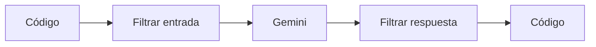

# Pasarela segura a Gemini

Única forma de llamar a Gemini desde el código. Filtra con el [servicio de protección de datos](proteccion-datos.md) lo que se envía y lo que se recibe. Si algo falla, devuelve `{ ok: false }`. Código en `src/ia/gemini/`.



No uses `src/ia/gemini/cliente.ts` directamente: no filtra nada.

## Respuesta de texto

```ts
import { consultarIA } from "./ia/gemini";

const resultado = await consultarIA({
  instrucciones: "Eres un tutor de Python de 480 Academy…", // sin datos personales
  mensajes: [{ rol: "usuario", texto: pregunta }],           // también admite el historial
  contexto: "Transcripción del módulo… Errores del alumno…",  // opcional
  alumno: { nombre, apellidos },                             // para filtrar su nombre
});

if (!resultado.ok) return;  // resultado.motivo
resultado.texto;            // "¡Hola, [NOMBRE]! Una tupla es…"
```

## Respuesta JSON

```ts
const resultado = await consultarIAJson<{ correcta: boolean }>({
  ...consulta,
  esquema: { type: "OBJECT", properties: { correcta: { type: "BOOLEAN" } }, required: ["correcta"] },
});

if (resultado.ok) resultado.datos.correcta;
```

Solo comprueba que sea JSON válido: valida tú su contenido.

## Errores

| `motivo` | Cuándo |
| --- | --- |
| `consulta_no_valida` | Faltan instrucciones, mensajes o esquema |
| `proteccion_entrada` | No se pudo filtrar la entrada. No se llama a Gemini |
| `proteccion_respuesta` | No se pudo filtrar la respuesta. No se devuelve |
| `respuesta_no_json` | Se pidió JSON y no lo es |
| `sin_clave` | Falta `GEMINI_API_KEY` en `.env` |
| `tiempo_agotado`, `error_red`, `error_gemini`, `respuesta_bloqueada`, `respuesta_vacia` | Fallos de Gemini o de la conexión |

## Límites

- Mensajes: 4.000 caracteres. Contexto: 30.000. Respuesta: 16.000.
- Las `instrucciones` no se filtran: los datos del alumno van en `contexto`.
- Si Gemini escribe el nombre del alumno, este verá `[NOMBRE]`.
