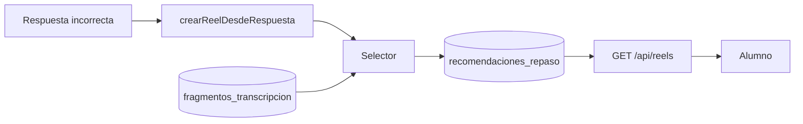

# Reels de repaso y Selector de repaso

Cuando el alumno falla una pregunta de un test de lección, se guarda un reel: el concepto, una recomendación y el tramo exacto del vídeo (máximo 60 s) que lo explica. Los reels forman una biblioteca persistente que el alumno consulta cuando quiere. Código en `src/reels/` y `src/routes/reels.ts`.

Responde a la historia de usuario HU-06, al agente «Selector de repaso» de [SPEC.md](../../SPEC.md#7-agentes-de-ia) y a la idea original del ciclo de repaso a partir de los errores.



## Estado actual

| Pieza | Estado |
| --- | --- |
| Selector sin IA (búsqueda en subtítulos) | Hecho |
| Servicio que guarda el reel | Hecho |
| API de la biblioteca | Hecho, ver [auth-api.md](../auth-api.md#reels-de-repaso) |
| Llamada desde los tests de lección | Pendiente: aún no existe el endpoint de esos tests |
| Selector con Gemini | Pendiente de la integración de IA |
| Pantalla de reels | Pendiente (frontend) |

## Cómo llamarlo

Después de guardar una respuesta con `es_correcta = false`:

```ts
import { crearReelDesdeRespuesta } from "../reels/servicio";

const resultado = await crearReelDesdeRespuesta(db, alumnoId, respuestaId);
// { creado: true, reelId: "8", nuevo: true }
// { creado: false, motivo: "examen_inicial" }
```

| `motivo` | Cuándo |
| --- | --- |
| `no_encontrada` | La respuesta no existe o es de otro alumno |
| `no_es_un_fallo` | La respuesta es correcta o no está corregida |
| `examen_inicial` | Es del examen inicial: mide conocimientos previos, no genera reels |
| `sin_video` | La pregunta no tiene un vídeo asociado |

Si el alumno vuelve a fallar la misma pregunta, no se crea otro reel: suma `veces_detectado` y vuelve a quedar pendiente.

## Cómo elige el tramo

De la fuente más fiable a la menos:

1. **`preguntas.tiempo_video`**, si quien creó la pregunta indicó el segundo exacto.
2. **Búsqueda en los subtítulos** del vídeo con las palabras de `configuracion.palabras_clave` y el `concepto` de la pregunta.
3. **Sin clip**: si no encuentra nada, el reel se guarda con la recomendación y la lección, pero sin tramo.

La búsqueda:

- Ignora mayúsculas y tildes, y solo cuenta palabras completas («range» no coincide con «arrange»).
- Prueba un tramo por cada fragmento que menciona el concepto, empezando 5 s antes para dar contexto y con un máximo de 60 s.
- Se queda con el tramo con **más menciones**, que es donde se explica el concepto, no con la primera aparición. En caso de empate, gana el primero.

No se recorta ni se genera vídeo: el reel guarda los segundos y el navegador reproduce ese tramo del vídeo original con `url#t=inicio,fin`.

## Palabras clave

Sirven cuando el vídeo y las preguntas están en idiomas distintos, como en la demo (subtítulos de CS50P en inglés y conceptos en español). Se guardan en cada pregunta:

```json
{ "palabras_clave": ["for loop", "loop"] }
```

Las escribe a mano quien prepara el curso, igual que el concepto y la explicación. Con vídeos en español suele bastar el propio concepto.

## Qué datos usa

| Dato | Origen |
| --- | --- |
| Enunciado, concepto, explicación, `tiempo_video`, palabras clave | `preguntas` |
| Subtítulos con sus segundos | `fragmentos_transcripcion` |
| Si la respuesta es correcta | `respuestas` |

La versión actual no envía nada a ningún servicio externo: todo se calcula en el servidor. Los textos que ve el alumno salen de la explicación escrita a mano en la pregunta, con un tono de aprendizaje («Pregunta para repasar»), no de castigo.

## Selector con Gemini (pendiente)

El SPEC prevé que Gemini Flash elija el fragmento cuando la búsqueda no basta. Condiciones para integrarlo:

- **Entrada:** enunciado, concepto y fragmentos de subtítulos del vídeo con sus segundos. Es contenido del curso: **ningún dato del alumno**.
- **Salida:** segundo de inicio, segundo de fin y título. El servidor valida que el tramo existe en el vídeo y dura como máximo 60 s antes de guardarlo.
- **Uso:** solo cuando el selector sin IA devuelve `null`, o una sola vez por pregunta, guardando el resultado en `tiempo_video` o en las palabras clave para no repetir la llamada con cada fallo.
- Si Gemini falla, el reel se guarda sin clip: el selector sin IA sigue siendo el plan B.

## Límites

- Si el concepto no aparece literalmente en los subtítulos y la pregunta no tiene `tiempo_video` ni palabras clave, el reel no tiene clip.
- Un concepto muy repetido a lo largo de un vídeo puede llevar a un tramo que lo menciona mucho pero no es la explicación principal.
- Los subtítulos no están en el repositorio: hay que importarlos (ver [LOCAL.md](../../LOCAL.md#subtítulos-para-los-reels)).
- Los fallos del examen inicial no generan reels.
